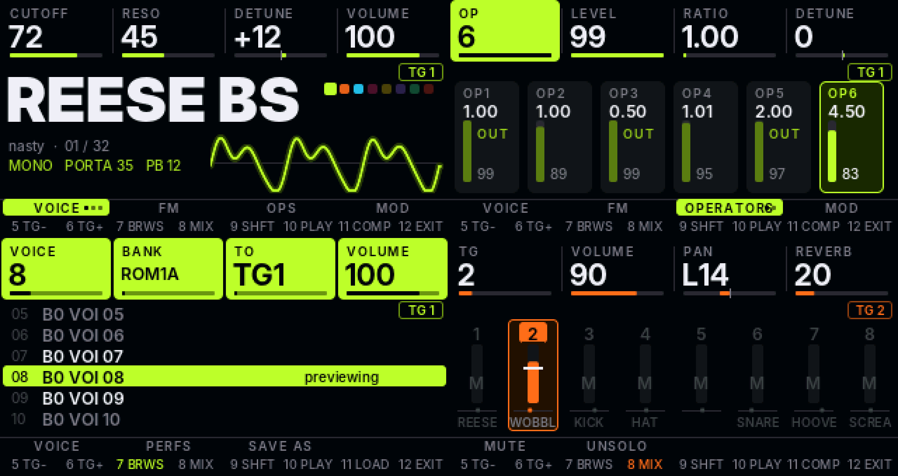
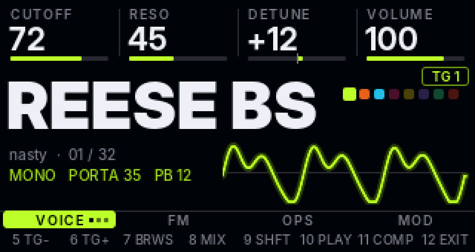
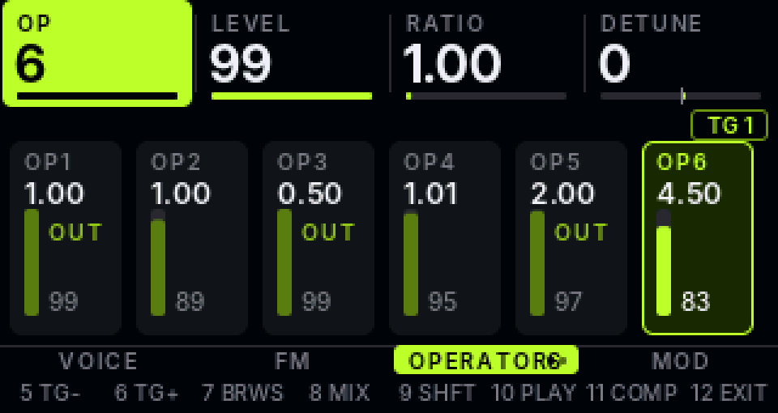
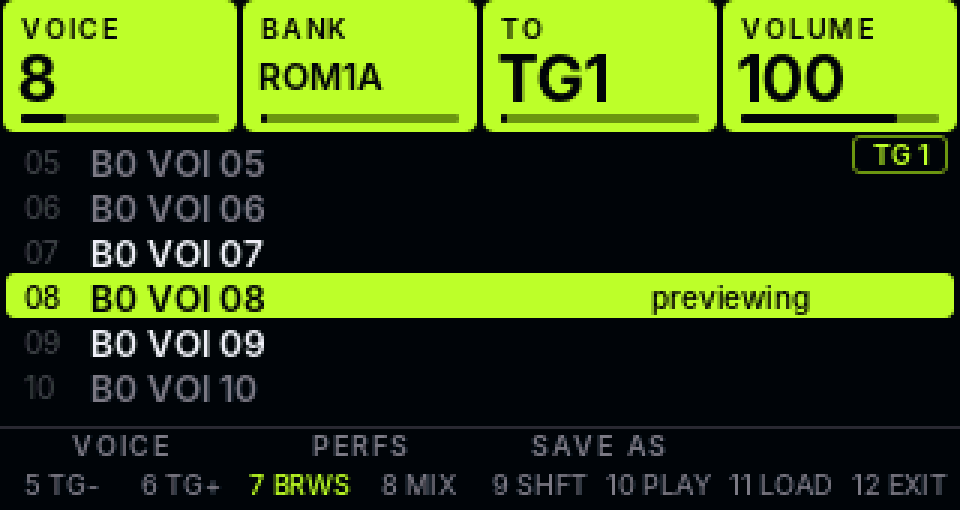
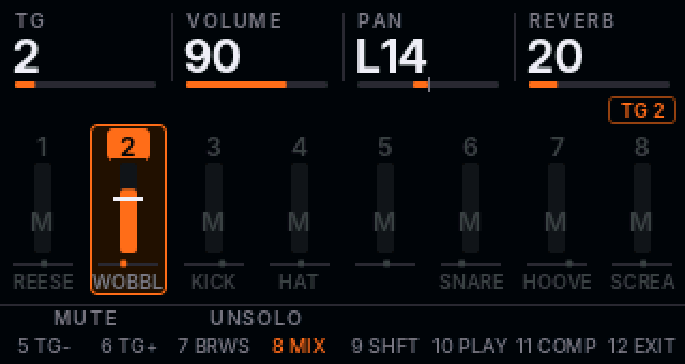

# ZicDexed

**An 8-voice FM monster in a box with 12 keys and 4 knobs.**

ZicDexed is [MiniDexed](https://github.com/probonopd/MiniDexed) (8 x DX7 FM tone generators, bare metal, no OS) rebuilt around the **ZicPixel**: a Pi Zero 2 W, a 320x170 colour screen, four encoders and twelve keys. No mouse, no menu diving. Every knob has a label right under it, and the whole screen takes the colour of the voice you are editing.

## Why you'll like it

- **Four lanes, four knobs.** The top of the screen is one lane per encoder, with a big value and a bar. Turn a knob and its lane lights up.
- **Eight tone generators, eight colours.** Lime, orange, sky, pink, yellow, violet, mint, red. You always know which one you are on.
- **Sound-design keys that are fun to abuse.** MUTATE nudges a voice at random, INIT gives a clean start, COMPARE (hold) shows you what you started with, REVERT takes you back. Hold PLAY to hear a note with nothing plugged in.
- **Macros for nasty sounds.** Bright, Snarl, Bite, Tail and Vel move several DX7 parameters at once, and the result still saves as a normal voice.
- **Browse by ear.** Every step through the voice list previews on the spot. Leave without LOAD and your old voice comes back.
- **Safe saves.** SAVE VOICE has a naming screen, writes through a temporary file and keeps a `.bak`. SAVE PERFORMANCE refuses to save while an operator is muted.
- **WiFi updates.** Push firmware, config and banks over FTP. WiFi MIDI too (AppleMIDI), since Circle has no Bluetooth.
- **Ships with 32 nasty DnB/electro voices** (bank 90): REESE BS, WOBBLE BS, NEURO STB, FM KICK, METAL SNR, HOOVER and friends.

## The box

Keys are numbered 1 to 12, top left to bottom right. Hold **9 (Shift)** and the screen turns into a live map of what the other keys do.

| Key | Does | With Shift |
|---|---|---|
| 1 | VOICE (press again: more sub-pages) | INIT |
| 2 | FM macros and algorithm | MUTATE |
| 3 | OPS, then envelopes | OP MUTE |
| 4 | MOD: LFO, pitch EG, FX | FX |
| 5 / 6 | previous / next TG | TG MUTE / TG SOLO |
| 7 | BROWSE | SAVE VOICE |
| 8 | MIX | SAVE PERFORMANCE |
| 9 | Shift | |
| 10 | PLAY (hold) | KEYS: keys 1-8 become scale pads |
| 11 | COMPARE (hold) | REVERT |
| 12 | EXIT (hold = panic) | stock MiniDexed menu |

Encoders speed up when you spin them. Hold Shift while turning for single steps.

## A look around

| | |
|---|---|
|  **VOICE**: name, bank, scope, per-TG settings |  **OPS**: six operator cards, carriers marked OUT |
|  **BROWSE**: scroll to preview, key 11 loads |  **MIX**: eight strips, mute and solo |

The screens above are not mock-ups: they are rendered on a PC by the same `src/ui` code the kernel runs (`make -C tests/ui shots`). The design notes are in [docs/ui-design.md](docs/ui-design.md), and how it is built is in [docs/firmware-ui.md](docs/firmware-ui.md).

## Hardware

Pi Zero 2 W, ST7789 1.9" 170x320 on SPI0 (DC GPIO3, RST GPIO17, no CS, SPI mode 3), PCM5102 I2S DAC, 4 encoders without push (26/13, 6/5, 0/9, 27/4), 12 keys on GPIO 20 16 25 14 / 12 1 24 15 / 7 8 23 22 (active low). MIDI comes in over USB: a USB host keyboard, `USBGadget=1` to play from a PC, or AppleMIDI over WiFi. There is no DIN/serial MIDI on this build.

## Quick start

1. Format an SD card as FAT32 and copy a MiniDexed release onto it.
2. Build with `./build.sh` (see [Building](#building)), then copy `kernel8.img` and `minidexed.ini` from `out/` to the card root.
3. Merge `out/sysex/voice/` into the card's `sysex/voice/` and copy the empty `performance` folder. Details in [SD card](#sd-card).
4. Power up. You land on VOICE for TG 1. Hold key 10 to hear it.

## Repo layout

| Path | What |
|---|---|
| `build.sh` | Clones MiniDexed at a pinned commit, applies `patches/`, adds `src/`, builds `out/kernel8.img` |
| `src/ui/` | Screen framework, pages, graphics and bitmap fonts. No Circle dependency |
| `src/glue/` | Keys, encoders, panel flush and the MiniDexed adaptor |
| `patches/circle/` | Circle patch (ST7789 170x320 row offset) |
| `patches/minidexed/` | MiniDexed hooks (ini keys, serial MIDI switch, UI hand-over, meters) |
| `config/minidexed.ini` | Settings for the ZicPixel |
| `sysex/voice/` | Extra voice banks (`000090_nasty.syx`: 32 DnB/electro patches). The stock Yamaha banks are not shipped: `python3 tools/stock_banks.py <Dexed cart dir> <out>` builds them as banks 1-27 with themed names. Bank 1 shown on the device is the firmware's built-in set only while no `000001_*.syx` is on the card |
| `tools/` | `fontgen.py` (Inter to bitmaps), `mockups/` (design renders), `sim/` (PC simulator), `hostsim/` ([UI on a fake SD card](docs/simulator.md)), `nasty_makebank.py`, `stock_banks.py` |
| `tests/ui/` | Host tests: `make -C tests/ui test` |

## Building

Needs the Arm GNU toolchain 13.3.rel1 `aarch64-none-elf` on `PATH`, then `./build.sh`. Set `SYNTH_DEXED_URL=https://github.com/probonopd/Synth_Dexed.git` if codeberg is unreachable. After a first full build, `ZIC_QUICK=1 ./build.sh` rebuilds only MiniDexed and the ZicDexed sources.

## SD card

1. Format the card as FAT32 and copy a MiniDexed release onto it.
2. Copy `kernel8.img` and `minidexed.ini` from `out/` onto the card root. This replaces the two files with the same name, which is what you want. Also copy `performance.ini`, the default performance loaded at power-on (TG 1 on nasty voice 1, OMNI, TGs 2-8 off). An older `performance.ini` on the card wins over the firmware defaults, so replace it (and delete any stale `000001_nasty.syx` from build 1-3 cards).
3. **Merge** `out/sysex/voice/` into the card's `sysex/voice/`. Never replace the folder: the stock banks live there. MiniDexed numbers banks from the 6-digit prefix of the file name, so a file with the same number as a stock bank hides it. The nasty bank uses 000090 for that reason, and SAVE VOICE writes bank 99.
4. If the stock banks have been lost or overwritten, rebuild them from your Dexed cartridge collection: `python3 tools/stock_banks.py <Dexed cart folder> <out folder>` writes 000001-000027 with themed names (Yamaha ROM3/ROM4 and VRC-101 to VRC-112). Copy them into `sysex/voice/`. The Yamaha banks are not stored in this repo.
5. Copy the empty `performance` folder from `out/` to the card root. SAVE PERFORMANCE needs it.
6. For WiFi, add a `firmware` folder and `wpa_supplicant.conf` as described in [docs/wifi.md](docs/wifi.md). Without them, set `NetworkEnabled=0` in `minidexed.ini`.

MIDI comes in over USB (USB host keyboard, or `USBGadget=1` to play from a PC), or over WiFi with AppleMIDI/RTP-MIDI once networking is turned on. Setup and firmware updates over WiFi are in [docs/wifi.md](docs/wifi.md).

## Licence

GPL-3.0, the same as MiniDexed and zicBox.
