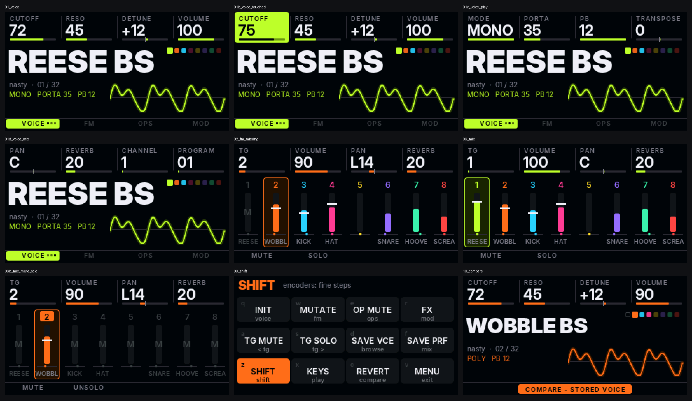

# ZicDexed

MiniDexed (8 x DX7 FM synth, bare metal) for the **ZicPixel** hardware. It uses the 320x170 screen, all 4 encoders and all 12 keys, with a control layout taken from zicBox.

Hardware: Pi Zero 2 W, ST7789 1.9" 170x320 on SPI0 (DC GPIO3, RST GPIO17, no CS, SPI mode 3), PCM5102 I2S DAC, 4 encoders without push (26/13, 6/5, 0/9, 27/4), 12 keys, numbered 1 to 12 left to right and top to bottom: GPIO 20 16 25 14 / 12 1 24 15 / 7 8 23 22 (active low).

## Status

First flashable build of the new UI: the screen framework (lanes, key band, per-TG colour, Shift key map), all 12 keys and 4 encoders with acceleration, the VOICE and MIX pages, PLAY and COMPARE, and the stock menu under Shift+12. FM, OPS, MOD, BROWSE and KEYS are the next pages and show a "not in this build" toast. The design is in [docs/ui-design.md](docs/ui-design.md), how it is built is in [docs/firmware-ui.md](docs/firmware-ui.md).

*Rendered on a PC by the same `src/ui` code the kernel runs (`make -C tests/ui shots`).*

## Layout

| Path | What |
|---|---|
| `build.sh` | Clones MiniDexed at a pinned commit, applies `patches/`, adds `src/`, builds `out/kernel8.img` |
| `src/ui/` | Screen framework, pages, graphics and bitmap fonts. No Circle dependency |
| `src/glue/` | Keys, encoders, panel flush and the MiniDexed adaptor |
| `patches/circle/` | Circle patch (ST7789 170x320 row offset) |
| `patches/minidexed/` | MiniDexed hooks (ini keys, serial MIDI switch, UI hand-over, meters) |
| `config/minidexed.ini` | Settings for the ZicPixel |
| `sysex/voice/` | Extra voice banks (`000001_nasty.syx`: 32 DnB/electro patches) |
| `tools/` | `fontgen.py` (Inter to bitmaps), `mockups/` (design renders), `sim/` (PC simulator), `nasty_makebank.py` |
| `tests/ui/` | Host tests: `make -C tests/ui test` |

## Building

Needs the Arm GNU toolchain 13.3.rel1 `aarch64-none-elf` on `PATH`, then `./build.sh`. Set `SYNTH_DEXED_URL=https://github.com/probonopd/Synth_Dexed.git` if codeberg is unreachable. After a first full build, `ZIC_QUICK=1 ./build.sh` rebuilds only MiniDexed and the ZicDexed sources.

## SD card

1. Format the card as FAT32 and copy a MiniDexed release onto it.
2. Copy the contents of `out/` (kernel8.img, minidexed.ini, sysex/) on top.

MIDI comes in over USB (USB host keyboard, or `USBGadget=1` to play from a PC), or over WiFi with AppleMIDI/RTP-MIDI once networking is turned on.

## Licence

GPL-3.0, the same as MiniDexed and zicBox.
