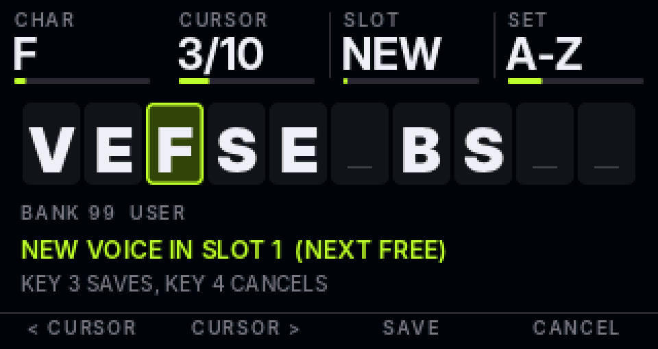

# ZicDexed firmware UI: how it is built

The screens in [ui-design.md](ui-design.md) run as real code. This page is for whoever adds a page or touches the input.

## Layers

| Folder | Depends on | What |
|---|---|---|
| `src/ui/` | nothing (plain C++14) | `Gfx` (320x170 RGB565 framebuffer, anti-aliased shapes, Inter bitmap text, dirty rectangles), `Ui` (lanes, key band, Shift map, input routing, page switching), the pages, the `ISynth` interface |
| `src/glue/` | Circle + MiniDexed | `CZicUI` (12 keys, 4 encoders, panel flush), `CZicSynth` (`ISynth` on top of `CMiniDexed`), the audio meter tap |
| `patches/minidexed/` | | Small hooks: ini keys, serial MIDI switch, UI hand-over, meter call |
| `tools/sim/`, `tests/ui/` | a PC | Runs the real `src/ui` code against a fake synth: screenshots and tests |

`build.sh` copies `src/ui`, `src/glue` and `src/logic` flat into MiniDexed's `src/`, lists the objects in `zicobjs.mk` and builds with C++17.

## Screen model

- Top 44 px: one **lane** per encoder (label, value, bar). Turning a knob lights its lane for 0.6 s.
- Middle 108 px: the page's picture. Bottom 18 px: labels for keys 1-4, sub-page dots, toasts.
- Everything takes the current TG's colour (`kTGColor`).
- Only changed pixels go to the panel. `Ui::tick()` runs the live parts (scope, level ticks, TG dots) at 25 fps and skips them when nothing moves, so an idle screen sends nothing. `CZicUI::Flush()` sends at most 2400 pixels per main-loop pass so MIDI and USB are never starved by SPI.

## Adding a page

1. Implement `zic::Page` (`src/ui/zicpage.h`): `lane()` gives label/text/bar for each encoder, `turn()` applies an encoder step, `draw()` paints the picture, `tick()` updates its live parts, optional `keyLabels()` and `key()`.
2. Talk to the synth only through `ISynth` (`src/ui/zicsynth.h`). Voices are the 155-byte unpacked DX7 layout; there are calls for loading and reading voices, notes, bank reading, reverb/compressor, mute and metering. The logic layer's `VoiceSink`, `ParamBus` and `BankSource` map one to one onto them.
3. Add a factory to `zicpages.h` and one line to `RegisterPages()` in `src/ui/zicregistry.cpp`. The slot decides which key reaches it (`SLOT_FM` = key 2, `SLOT_OPS` = key 3, `SLOT_MOD` = key 4, `SLOT_BROWSE` = key 7, `SLOT_KEYS` = Shift+key 10). An empty slot shows a "not in this build" toast.
4. Add the page to `tools/sim/sim.cpp` for a screenshot and to `tests/ui/ui_test.cpp`.

`Ctx` hands a page the `Gfx`, the `ISynth`, the `Ui` (current TG, mute/solo, smoothed level meter) and the clock. Encoder steps arrive already accelerated; with Shift held the raw step arrives and `fine` is true.

## Input

| | |
|---|---|
| Keys | Keys 1-12, numbered top left to bottom right (rows 1-4 / 5-8 / 9-12), on GPIO `20 16 25 14 / 12 1 24 15 / 7 8 23 22`, active low, 6 ms debounce |
| Encoders | 1..4 on GPIO `26/13, 6/5, 0/9, 27/4`, interrupt driven. Turn speed sets the step: under 12 ms per click x6, under 25 ms x3, under 60 ms x2, else x1 |
| Direction | `ZicEncoderInvert` in `minidexed.ini`: bit n reverses encoder n+1 |

Keys: 1 VOICE (press again for sub-pages), 2 FM, 3 OPS, 4 MOD, 5/6 TG-/TG+, 7 BROWSE, 8 MIX (press again for the MASTER volume lane), 9 SHIFT (hold 0.25 s shows the key map), 10 PLAY (hold), 11 COMPARE (hold), 12 EXIT home (hold 0.7 s = panic). With Shift: 1 INIT, 2 MUTATE, 3 OP MUTE, 4 FX, 5 TG mute, 6 TG solo, 7 SAVE VOICE, 8 SAVE PERFORMANCE, 10 KEYS pads, 11 revert, 12 stock menu.
Errors (full user bank, no performance folder, failed load) stay on screen until the next key press; other messages last 1.4 s. Mutes are re-applied about every 0.1 s, so a performance load or a MIDI expression message cannot un-mute a muted TG.

In the stock menu: key 12 select, key 11 back, key 7 home, keys 5/6 program, keys 1/2 TG, keys 3/4 bank, any encoder scrolls, Shift+key 12 returns to the ZicDexed screens.

## ini keys (config/minidexed.ini)

| Key | Default | |
|---|---|---|
| `ZicUI` | 0 | 1 = ZicDexed screens, 0 = stock text menu |
| `SerialMIDIEnabled` | 1 | 0 frees GPIO 14/15 for keys r and f |
| `ZicEncoderInvert` | 0 | bit mask, see above |

With `ZicUI=1` the stock `ButtonPin*` and `EncoderEnabled` must be off (the shipped ini does that) so nothing else claims the pins.

## Checks on the hardware

1. Screen shows VOICE in the TG1 colour, not shifted or flipped (`ST7789Rotation` if so).
2. Each key does something; keys 9, 10, 4 and 8 are the ones that share pins with SPI and UART.
3. Each encoder lights its own lane; if one runs backwards set its bit in `ZicEncoderInvert`.
4. With a USB keyboard playing: the scope moves, the TG dots light, MIX level ticks follow.
5. Hold key 10 and hear a note with nothing plugged in; hold key 11 and hear the stored voice, release and get your edit back.

## Sound-design pages (FM, OPS, ENV, MOD, BROWSE, KEYS)

`src/logic/` holds the lane tables and edit logic; `src/ui/soundhub.*` and `src/ui/soundpages.cpp` map them onto the framework. Screenshots: [sound_pages.png](screens/sound_pages.png), all 32 algorithms in [algorithms.png](screens/algorithms.png) (`make -C tests/ui sound_shots`).

| Key | Page |
|---|---|
| Key 2 | FM: Algo, Feedback, Bright, Snarl. Press again: Bite, Tail, Vel, Sync |
| Key 3 | OPS: Op, Level, Ratio (Shift = fine), Detune. Press again: operator envelope, rates (Shift = levels) |
| Key 4 | MOD: LFO (wave, speed, pitch, amp), pitch EG, FX (reverb size, damping, level, compressor) |
| Key 7 | BROWSE: turning Voice previews on the target TG; key 11 loads, leaving the page undoes the preview. Key 2 switches the list to the performances on the card (/SD/performance): encoder 1 scrolls, encoder 2 steps through the performance banks (the sub-folders such as `001_Seed`), resting on a performance for about half a second previews it (it sounds and is marked "previewing"; it replaces every TG's voice and settings, so save unsaved edits first), key 11 keeps the previewed one, leaving with key 12 or key 2 puts the originally loaded performance back, key 2 goes back to voices; the performance that is loaded is marked. Stepping banks only changes the list: leaving without loading puts the synth back on the bank of the loaded performance, so Shift+key 8 never writes into a bank you were only looking at. Key 3 keeps the previewed voice and opens the naming screen: RENAME in the user bank (overwrites that slot with the new name), SAVE AS in any other bank (a renamed copy goes into the user bank) |
| Shift+key 10 | KEYS: keys 1-8 play the current scale on the current TG |
| Shift+keys 1/2/3 | INIT, MUTATE, OP MUTE (selected operator) |
| Shift+key 4 | FX: jumps to the MOD page's effects sub-page |
| Shift+key 7 | SAVE VOICE: opens the naming screen (below). The voice goes into the user bank `sysex/voice/000099_ZICUSER.syx` (bank 99, 32 slots) and shows up in BROWSE straight away |
| Shift+key 8 | SAVE PERFORMANCE: needs a `performance` folder at the card root (MiniDexed refuses to save without it; `build.sh` puts one with the stock performance banks in `out/`; merge it into the card's folder without overwriting files already there). Overwrites the current performance, i.e. every TG's voice (edits included), levels, pans and the effects |

### SAVE VOICE screen

It starts with the current voice's name. Encoder 1 changes the character under the cursor (space, A-Z, 0-9, a-z, then a few symbols), encoder 2 moves the cursor, encoder 4 jumps between character sets. Keys 1 and 2 also move the cursor left and right. Encoder 3 chooses the slot: NEW is the first free slot, or 1 to 32 to overwrite one. A name that already exists in the bank picks its own slot by itself and the screen says OVERWRITES in orange. Key 3 saves and returns to the page you came from, key 4 or key 12 cancels. A blank name, or the name INIT VOICE (which marks a free slot), is refused.

**Rename from BROWSE:** key 3 on the BROWSE page. In the user bank (bank 99) it is RENAME: the naming screen opens with that slot already chosen, so key 3 writes the new name back into the same slot. In any other bank it is SAVE AS, and the stock banks are never modified. Cancelling leaves the previewed voice loaded on the TG.

MiniDexed only reads its bank files at boot, so BROWSE is served from a copy kept after each save; the saved voice is there at once. Loading bank 99 by MIDI program change still sees the boot-time contents until the next restart.

The hub keeps one `EditSession` per TG and re-reads the synth's live voice on every entry point, so COMPARE, revert, program changes and SysEx all show up. FM macro amounts reset to 0 when that happens. OP MUTE only silences the sound. SAVE VOICE saves the edit voice, so muted operators are saved at their real level; SAVE PERFORMANCE saves what the synth is playing, so un-mute first.
