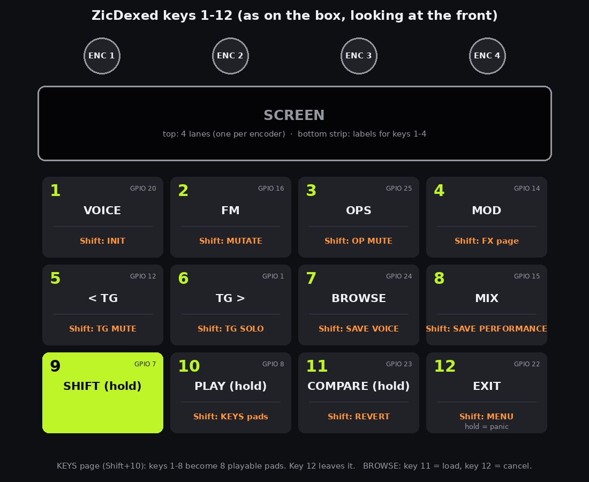
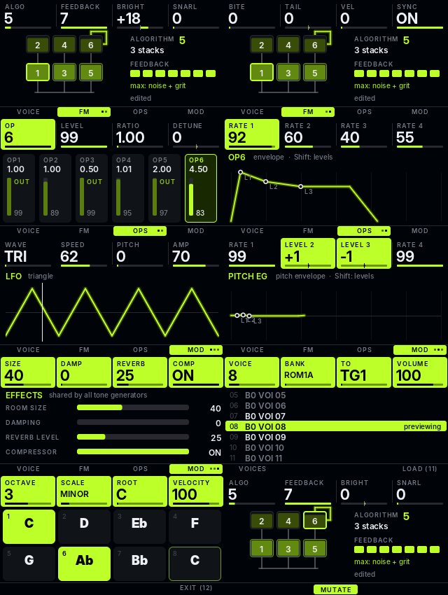

# ZicDexed walkthrough

A guided tour of the box: switching on, picking sounds, changing them, saving them, and using all eight tone generators (TGs) together.

Keys are always called by number, 1 to 12, top left to bottom right, as on the map below. The four encoders are 1 to 4, left to right, above the screen. Everything here was checked against the firmware source on `main` (build 15). The WiFi/FTP parts are confirmed on the hardware; for the rest, the places where behaviour is subtle or untested on the box are marked **Note**.

## 1. The screen in 30 seconds

- **Top strip: four lanes**, one per encoder. Each shows a name, a value and a bar. Turn an encoder and its lane lights up for about half a second.
- **Middle: the picture** for the current page (voice name and scope, algorithm diagram, envelope, mixer strips, voice list).
- **Bottom strip: key labels.** The upper row names keys 1 to 4 (the page keys, or what they do on the current page). The lower row names keys 5 to 12 ("5 TG-", "6 TG+", "7 BRWS", "8 MIX", "9 SHFT", "10 PLAY", "11 COMP", "12 EXIT"; pages swap in their own, like "11 LOAD" in BROWSE). Short messages ("VOICE LOADED", "TG MUTED") cover the strip and disappear by themselves. **Error messages stay until your next key press.**
- **Top right:** every page shows a **TG n** tag, and an **amber dot** appears while the current TG's voice has **unsaved edits**.
- **Colour = which TG you are on.** Everything takes the colour of the current TG: 1 lime, 2 orange, 3 sky blue, 4 pink, 5 yellow, 6 violet, 7 mint, 8 red.
- **Encoders speed up** when you turn them fast (up to six steps per click) and give single steps when you turn slowly. **Hold key 9 (Shift) while turning** for exact single steps ("fine").
- **Hold key 9 for a quarter of a second** and the screen shows what every key does while Shift is held. It also shows the WiFi state or IP address at the top right.

The pages you reach with the unshifted keys:

| Key | Page | Encoders 1 to 4 |
|---|---|---|
| 1 | VOICE (press again for the next of 3 sub-pages) | Cutoff, Reso, Detune, Volume / Mode, Porta, PB, Transpose / Pan, Reverb, Channel, Program |
| 2 | FM (press again for sub-page 2) | Algo, Feedback, Bright, Snarl / Bite, Tail, Vel, Sync |
| 3 | OPS (press again for the envelope) | Op, Level, Ratio, Detune / Rate 1 to 4 |
| 4 | MOD (press again: LFO, Pitch EG, FX) | Wave, Speed, Pitch, Amp / Rate 1 to 4 / Size, Damp, Reverb, Comp |
| 5, 6 | previous TG, next TG (wraps around 8 to 1) | |
| 7 | BROWSE | Voice, Bank, To (target TG), Volume |
| 8 | MIX | TG, Volume, Pan, Reverb |
| 9 | SHIFT (hold) | |
| 10 | PLAY (hold) | |
| 11 | COMPARE (hold) | |
| 12 | EXIT: back to VOICE. Hold for 0.7 s = panic, all notes off | |

## 2. Getting started

1. Put the card in and power up. The screen opens on **VOICE for TG 1**. The first line of the picture is the voice name, under it the bank name and the program number out of 32.
2. **Hear something.** You have three ways to make a note without any other gear:
   - **Hold key 10 (PLAY).** Plays a middle C on the current TG while held.
   - **Shift + key 10 (KEYS)** turns keys 1 to 8 into eight playable pads in a scale (default C minor). Encoders: Octave, Scale, Root, Velocity. Key 12 leaves.
   - **A USB MIDI keyboard** into the Pi's USB port (or `USBGadget=1` to play from a PC, or AppleMIDI over WiFi; see [wifi.md](wifi.md)). There is no DIN/serial MIDI on this build.
3. PLAY and the KEYS pads sound **only the current TG**, whatever its MIDI channel is set to. A keyboard only reaches the TGs whose **Channel** matches (section 6).
4. **Nothing playing, or notes stuck?** Hold key 12 for 0.7 s (panic).

**Note:** the builds ship a default `performance.ini` (the stock MiniDexed "Rock Piano": TGs 1 to 3 layered on OMNI, TGs 4 to 8 OFF), so you hear that at power-on. The file must be called exactly `performance.ini` in the card root; Windows can hide a `.txt` on the end. With no `performance.ini` on the card at all, MiniDexed starts with TG 1 listening on OMNI (every channel) and TGs 2 to 8 set to OFF. So a keyboard plays TG 1 only until you set the other TGs' channels and save (section 5). If a `performance.ini` is already on the card, the channels come from that instead; check Channel on VOICE sub-page 3.

## 3. Changing bank and instrument

A **bank** is a file of 32 voices. A **voice** is one DX7 sound. Each TG has its own bank and voice.

### The normal way: BROWSE (key 7)

1. Press key 5 or 6 until you are on the TG you want to change (or use encoder 3 "To" inside BROWSE, below).
2. Press **key 7**. You get a list of the voices in that TG's bank, with the current one highlighted. Keys 2 and 3 now do BROWSE jobs (PERFS, and RENAME or SAVE AS, see below).
3. **Encoder 1 (Voice)** scrolls the list. Every step **previews the voice immediately** on the target TG: play a note and you hear it. The row says "previewing".
4. **Encoder 2 (Bank)** jumps to the next bank that exists on the card. The voice list and the name in the lane change. Turn slowly to move one bank at a time.
5. **Encoder 3 (To)** picks which TG gets the preview. Moving it puts the old TG's voice back and starts auditioning on the new one.
6. **Encoder 4 (Volume)** sets that TG's volume while you listen.
7. **Key 11 (LOAD)** keeps the voice: the TG's bank and program are set to it, you see "VOICE LOADED", and you land on VOICE. If you have not previewed anything it says "NO CHANGE" and stays. If the TG had **unsaved edits** when you opened BROWSE, the first press says "UNSAVED EDITS - LOAD AGAIN" and a second press goes ahead.
8. **Leaving any other way** (key 12, key 1, key 8, and so on) **undoes the preview**: the TG gets its old voice back, edits included.

**Note:** inside BROWSE, change TG with encoder 3, not keys 5/6. In the current code, keys 5/6 restart the browse list on the other TG without putting the first TG's voice back, so a preview on the old TG would be left in place.

### Performances and renaming in BROWSE

- **Key 2 (PERFS)** swaps the list for the card's **performances**. Encoder 1 scrolls them, the one currently loaded is marked "loaded", **key 11 loads** the highlighted one ("PERFORMANCE LOADING"), and key 2 again (now labelled VOICES) goes back to the voice list. **Loading a performance replaces every TG's voice and settings**, so save anything you want first.
- **Key 3** is **RENAME** when the list is the user bank (ZICUSER) and **SAVE AS** on any other bank. Either one keeps the previewed voice on its TG and opens the SAVE screen (section 5), on the voice's own slot in ZICUSER for RENAME, or on NEW for SAVE AS.

### Banks on the card

| Bank | What |
|---|---|
| 1 to 27 | The stock Yamaha ROM and VRC banks, with themed names (Mixed Classics, Keys & Guitars, Orchestral, Drums, SFX, Tomlyn Pads Lead, and so on). Built by `tools/stock_banks.py`, see the README |
| 90, "nasty" | 32 DnB and electro voices: REESE BS, WOBBLE BS, NEURO STB, GRIT SUB, FM KICK, METAL SNR, ACID SQLCH, HOOVER and more |
| 99, "ZICUSER" | Your own saved voices (section 5) |

### The quick way: Program on VOICE

Press key 1 twice more (the third VOICE sub-page: Pan, Reverb, Channel, Program). **Encoder 4 (Program)** steps through the 32 voices of the **current bank**, one per click, and loads each. Use it to flick through a bank; use BROWSE to change bank.

**Warning:** changing the program (or loading a voice from BROWSE) **throws away unsaved edits** on that TG. Save with Shift + key 7 first if you want to keep them.

### The stock menu

Shift + key 12 opens MiniDexed's original text menu (TG settings, effects, performances). Its last line reminds you "Shift+12=ZicDexed". In it: key 12 = select, key 11 = back, key 7 = home, keys 5 and 6 = program down and up, keys 1 and 2 = TG down and up, keys 3 and 4 = bank down and up, and any encoder scrolls. **Shift + key 12 returns to the ZicDexed screens.**

## 4. Editing the sound

Edits always apply to the **current TG** and are heard straight away. They change the live voice only: nothing is written to the card until you save.

### FM (key 2): the big levers

Encoder lanes, and what they do:

| Lane | What it does |
|---|---|
| Algo | Which of the 32 DX7 algorithms. The diagram shows which operators feed which; lower boxes are the carriers (what you hear), upper ones modulate |
| Feedback | 0 to 7. More = from warm to buzzy to noise |
| Bright | Raises or lowers the modulators' output levels. More modulation = more harmonics |
| Snarl | Pushes feedback up and detunes the modulators against each other: rougher, nastier |
| Bite (key 2 again) | Gives modulators a fast hard attack that settles lower, so the start of the note is brighter than the body |
| Tail | Longer (+) or shorter (−) release |
| Vel | How much velocity brightens the sound |
| Sync | Oscillator key sync on or off |

The five macros (Bright, Snarl, Bite, Tail, Vel) are shortcuts that move several ordinary DX7 parameters at once, so the result saves as a normal voice. Turn a macro back to 0 and you get the original back **until you edit any other parameter**: that edit makes the current sound the new starting point and the macros read 0 again.

### OPS (key 3): one operator at a time

- **Encoder 1 (Op)** chooses operator 1 to 6. The FM diagram and the OPS picture highlight it, and Shift + key 3 (OP MUTE) acts on it.
- **Level** is the operator's output. **Ratio** is the coarse frequency ratio; **hold Shift for the fine ratio**. Voices with a fixed-frequency operator show it in Hz. **Detune** is ±7.
- **Press key 3 again for the ENVELOPE** of that operator: encoders 1 to 4 are Rate 1 to 4, and **holding Shift switches them to Level 1 to 4**. The drawing shows the shape.

### MOD (key 4)

Press key 4 repeatedly to move through three sub-pages (the key label shows which): **LFO** (Wave, Speed, Pitch depth, Amp depth), **PITCH EG** (rates 1 to 4, Shift for levels; level 0 on the lane means "no change"), and **FX** (reverb Size, Damp, Level and the Compressor on or off).

**The FX are shared by all eight TGs.** Each TG's own Reverb lane (VOICE sub-page 3, or MIX) is how much of that TG goes into the shared reverb.

### Per-TG settings on VOICE (key 1)

These are not part of the DX7 voice. They belong to the TG, and they are stored in a **performance**, not in a saved voice.

| Sub-page | Lanes |
|---|---|
| 1 | Cutoff and Reso (a filter on the TG's output), Detune (TG tuning, −99 to +99), Volume |
| 2 | Mode (turn right = MONO, left = POLY), Porta (portamento time), PB (pitch-bend range), Transpose (this one is a voice parameter, so a saved voice keeps it) |
| 3 | Pan, Reverb (send level), Channel (MIDI channel), Program |

### Quick sound-design tools (hold Shift, then press)

| Keys | What |
|---|---|
| Shift + 1: INIT | Resets the TG's edit to a plain init voice, a clean start |
| Shift + 2: MUTATE | Makes a few small random changes (ratios, levels, feedback, detune, modulator envelopes). Carrier levels are kept audible. Press again for more. Shift + 11 undoes the last one |
| Shift + 3: OP MUTE | Silences the selected operator, so you hear what it contributes. Press again to bring it back. It only changes the sound you hear: a saved voice keeps the operator at its real level |
| Hold 11: COMPARE | While held, you hear the **stored** voice (the last one loaded or saved). Let go and your edit is back |
| Shift + 11: UNDO | The first press undoes the last INIT, MUTATE or voice load ("UNDID MUTATE"). Press again to drop all your edits and go back to the stored voice ("REVERTED"). "NOTHING TO REVERT" when there are no edits |

## 5. Saving and recalling

There are two things you can save, and they hold different things.

| | A voice | A performance |
|---|---|---|
| What it is | One sound (the DX7 voice, including operator, LFO, pitch EG, algorithm, transpose and name) | The whole box: all 8 TGs' voices (edits included), bank and program, MIDI channels, volume, pan, reverb sends, cutoff, resonance, detune, mono, portamento, pitch bend, plus the shared reverb and compressor |
| Save | **Shift + key 7** (SAVE VCE), which opens a naming screen | **Shift + key 8** (SAVE PRF) |
| Goes to | The user bank `sysex/voice/000099_ZICUSER.syx` (bank 99) | The current performance. Out of the box that is the default one, `performance.ini` on the card |
| Needs | Nothing special | A **`performance`** folder at the card root (the builds ship one with the stock MiniDexed banks; merge it into the card's folder without overwriting files already there). Without it you get "NO PERFORMANCE FOLDER ON SD" |
| Comes back | In BROWSE: bank "ZICUSER" | By itself at **power-on** (the default performance loads at boot), or from BROWSE with key 2 (PERFS) |

### Saving a voice

1. Edit the sound on the TG you like. The amber dot top right shows it has unsaved edits.
2. Press **Shift + 7**. A **SAVE** screen opens with the voice's current name in ten character cells and a line saying what the save will do.
3. **Name it.**
   - **Encoder 1 (Char)** changes the character under the cursor.
   - **Encoder 2 (Cursor)**, or **keys 1 and 2** (left and right), moves the cursor.
   - **Encoder 4 (Set)** jumps the character between SPACE, A-Z, 0-9, a-z and symbols, so you do not have to scroll the whole list.
4. **Choose where it goes** with **encoder 3 (Slot)**: **NEW** puts it in the first free slot of the user bank (bank 99, 32 slots), or pick slot 1 to 32 to overwrite that one. If you leave it alone and the name matches a voice already in the bank, it targets that voice's slot and the screen warns "OVERWRITES SLOT n". Turning encoder 3 yourself overrides this.
5. **Key 3 saves.** The toast says "SAVED IN SLOT n OF BANK 99" (or "OVERWROTE SLOT n") and you return to the page you came from. **Key 4 or key 12 cancels** with nothing written. Keys 5 and 6 do nothing here, so the TG cannot change under you.
6. A blank name, or "INIT VOICE", is refused ("GIVE IT A NAME FIRST"). If all 32 slots are taken you get "USER BANK FULL - PICK A SLOT". Error messages stay until your next key.
7. The new voice shows up in **BROWSE under ZICUSER straight away** (key 7, encoder 2 to ZICUSER, encoder 1 to the voice, key 11 to load).

To **rename** a saved voice, use **key 3 (RENAME) in BROWSE** on the ZICUSER bank. To save a stock voice under your own name, use **SAVE AS** (the same key on any other bank).

Saves are made safely: the firmware writes a temporary file, checks it, keeps the previous bank as a `.bak` backup, and only then swaps the new file in. If the bank file ever cannot be read, the SAVE screen becomes a **RESET** screen instead: press **key 3 twice** and it restores the backup if that is good, otherwise starts an empty bank, then carries on to the naming screen.

**Note:** a MIDI program change to bank 99 from a keyboard still sees the bank as it was at power-on until you restart, because MiniDexed reads its bank files only at start-up. BROWSE and the SAVE screen always show the current contents. If you upload banks over FTP, reboot afterwards.

Saving a voice saves the **edit voice**, so a muted operator (Shift + 3) is saved at its real level.

### Saving a performance

Press **Shift + 8**. The toast says "PERFORMANCE SAVED". It **overwrites the current performance**: every TG's voice including your edits, all the TG settings above, and the effects. If any TG has a **muted operator** (Shift + 3) it refuses ("OP 3 MUTED - UNMUTE FIRST", or "TG 2 OP 3 MUTED" for another TG), because a performance saves what the synth is playing and would store the operator silent. Without a `performance` folder you get "NO PERFORMANCE FOLDER ON SD".

Because of that, treat Shift + 8 as "save my whole setup". A good routine: get TG 1 to 3 sounding right, set their channels, check the mix, then Shift + 8. At the next power-on it all comes back, edits included.

**Not saved:** the TG mute and solo states (Shift + 5/6). They reset to normal at every start. The master volume (MIX, key 8 pressed again) is not stored in the voice either.

### Several performances

Shift + 8 overwrites the one you are on. To **switch** performances use **BROWSE, key 2 (PERFS)**, scroll with encoder 1 and press key 11. To **create** a new one, use the stock menu (Shift + key 12): **Performance → Save → New** makes a new numbered file. **Delete** and **Bank** live there too. Return with Shift + 12.

**Note:** the stock menu's name entry for "New" has not been tried on the hardware yet.

## 6. The eight TGs

Each TG is its own complete DX7. Eight of them run at once and share one reverb and one compressor. The current TG is the one the lanes, pages, PLAY and the colour refer to; keys 5 and 6 move it.

### Who hears what: the MIDI channel

VOICE, sub-page 3 (key 1 twice more), **encoder 3 = Channel**:

| Value | Meaning |
|---|---|
| 1 to 16 | The TG answers MIDI on that channel only |
| OMNI | The TG answers on every channel |
| OFF | The TG ignores MIDI altogether |

Ways to use that:

- **Layer.** Give TG 1 and TG 2 the same channel (or both OMNI). One keyboard plays both sounds at once. Adjust their balance with Volume in MIX.
- **Multi-timbral.** Give every TG its own channel (1 to 8) and let a DAW or sequencer play eight parts on the one box.
- **Split by hand.** Two TGs on different channels, and change your keyboard's channel to move between them.
- A TG on OFF is switched off for MIDI but still makes sound for PLAY and KEYS, so you can build its sound before assigning a channel.

### Seeing all eight: MIX (key 8)

Eight strips, each in its TG colour with a live level tick. The current TG is outlined. Encoders: **TG** (which one), **Volume**, **Pan**, **Reverb** send. Fast turns on the Volume lanes move at most 4 steps per click, so a quick flick cannot jump the level. A grey "M" on a strip means it is muted or silenced by a solo. **Press key 8 again** for a **MASTER** lane (encoder 2) next to the TG lane: the overall output volume.

On the MIX page **keys 1 and 2 are MUTE and SOLO** for the current TG, and keys 3 and 4 do nothing. So to leave MIX for FM, OPS or MOD, press key 12 (VOICE) first. Keys 5 to 7 and 12 behave as usual. On VOICE, a row of eight small squares in the top right also shows the TGs: the current one is solid, muted ones are hollow, and ones playing a note glow brighter.

### Turning TGs off and on

| What you want | How | Remembered? |
|---|---|---|
| Silence one TG for a moment | Shift + 5 (TG MUTE) on that TG. Press again to un-mute. The mute holds even through a performance load or MIDI volume (expression) messages | No: back to normal at next start |
| Hear one TG alone | Shift + 6 (TG SOLO). Everything else is silenced. Solo several TGs to hear them together. Press again to clear | No |
| Take a TG out of the MIDI game | Channel = OFF (VOICE sub-page 3) | Yes, in a performance (Shift + 8) |
| Turn a TG down without muting | Volume (VOICE sub-page 1, or MIX) | Yes, in a performance |

A TG that is both muted and soloed stays muted. Mute and solo are about the **sound you hear**; the TG keeps running. Use Channel OFF to stop it responding to MIDI.

### Example: a bass, a lead and a drum voice from one keyboard

1. TG 1: BROWSE (key 7), pick nasty "REESE BS", key 11. VOICE, sub-page 3: Channel = 1.
2. Press key 6 to go to TG 2. BROWSE, pick "FM KICK", key 11. Channel = 2.
3. Key 6 again for TG 3, pick a lead from bank 90, Channel = 3.
4. MIX (key 8): set Volume and Pan for each strip, use key 1/2 to mute or solo while you balance them.
5. Press key 12 to leave MIX, then Shift + 8 to save the setup.

## 7. Cheat sheet

| Key | Plain | With Shift (key 9 held) |
|---|---|---|
| 1 | VOICE (again: next sub-page) | INIT |
| 2 | FM (again: macros 2) | MUTATE |
| 3 | OPS (again: envelope) | OP MUTE |
| 4 | MOD (again: LFO, Pitch EG, FX) | FX page |
| 5 | previous TG | TG MUTE |
| 6 | next TG | TG SOLO |
| 7 | BROWSE (key 2 PERFS, key 3 RENAME / SAVE AS, key 11 LOAD) | SAVE VOICE (naming screen) |
| 8 | MIX (again: MASTER) | SAVE PERFORMANCE |
| 9 | SHIFT | |
| 10 | PLAY (hold) | KEYS pads |
| 11 | COMPARE (hold) | UNDO, then revert |
| 12 | EXIT to VOICE (hold = panic) | stock MENU |

Shift + an encoder = fine steps; on ENV and PITCH EG it switches rates to levels; on Ratio it switches coarse to fine.

## 8. Things that catch people out

- **A MIDI track resets the voices.** Players and sequencers send Program Change (often 0 on every channel) at the start, stop or end of a track, and MiniDexed reloads the voice on every TG on that channel. The shipped `minidexed.ini` has `MIDIRXProgramChange=0`, so MIDI no longer changes voices. Set it to 1 if you want a track to choose them. The same reset also sends volume, pan and expression (CC 7, 10, 11), which jumped the levels up at the end; `MIDIRXMixerCC=0` ignores those too (set 1 to let a track mix the TGs). Needs the new kernel build.
- **Switching voice drops edits.** Program changes (the Program lane, MIDI) and loading a performance replace the TG's voice without asking. BROWSE LOAD asks once. Look for the amber dot, and save first (Shift + 7), or use COMPARE and UNDO to see what you would lose.
- **Check the slot on the SAVE screen.** A name that already exists in ZICUSER targets its own slot, and key 3 then overwrites it. Pick NEW with encoder 3 to keep both.
- **Shift + 8 refuses while an operator is muted.** Un-mute it (Shift + 3) first.
- **Shift + 8 is a whole-box overwrite** of the current performance.
- **Cutoff, Reso, Volume, Pan, Channel and so on are not part of a saved voice.** They live in the performance.
- **Do not replace the card's `sysex/voice` folder** when updating. Merge new banks into it, or the stock banks disappear. See the README for the SD steps.
- **WiFi without its files** (the `firmware` folder and `wpa_supplicant.conf`) can stall start-up. Set `NetworkEnabled=0` in `minidexed.ini` until they are on the card. Details in [wifi.md](wifi.md).

## 9. Where to look next

*FM, OPS, ENV, LFO, Pitch EG, FX, BROWSE and KEYS as rendered by the firmware's own drawing code.*

- [ui-design.md](ui-design.md): why the screens look the way they do.
- [firmware-ui.md](firmware-ui.md): how the UI is built, and the hardware checks.
- [wifi.md](wifi.md): setting up WiFi, updating over FTP, network MIDI.
- [simulator.md](simulator.md): run the real UI on a PC against a fake SD card, with key scripts.
